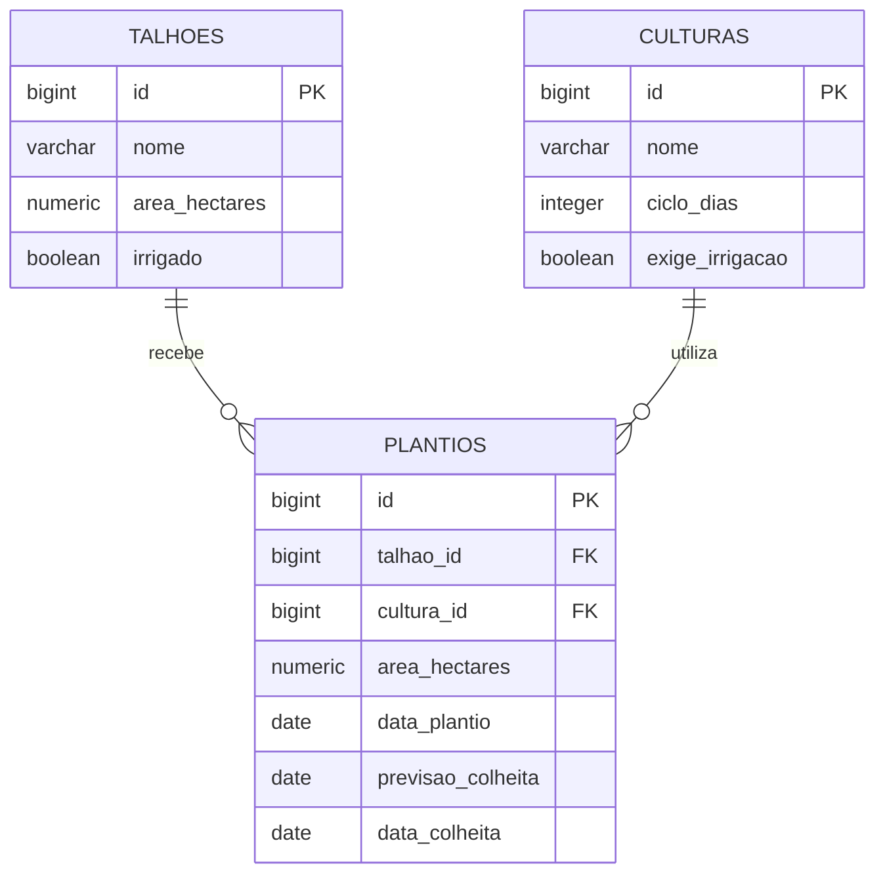

# Modelo de domínio

Responsável: Henrique Jochen, em alinhamento com Thiago para Plantio.

Talhão e Cultura estão implementados. Plantio, suas chaves estrangeiras e seus relacionamentos JPA ainda são planejados. O diagrama representa o modelo completo pretendido, não o estado atual do banco.

## Diagrama ER

Um talhão pode ter zero ou muitos plantios; uma cultura pode aparecer em zero ou muitos plantios. Cada plantio pertence a exatamente um talhão e uma cultura. As duas chaves estrangeiras ficarão em plantios, sem exclusão em cascata.

## Talhão — implementado

Tabela: talhoes. Migration: V1__criar_talhoes.sql.

| Coluna | Tipo SQL | Atributo Java | Obrigatório / restrição |
|---|---|---|---|
| id | BIGINT | Long id | Chave primária gerada por identidade |
| nome | VARCHAR(100) | String nome | NOT NULL; DTO exige nome não vazio e até 100 caracteres |
| area_hectares | NUMERIC(12,2) | BigDecimal areaHectares | NOT NULL e CHECK > 0; DTO exige mínimo 0,01, até 10 dígitos inteiros e 2 decimais |
| irrigado | BOOLEAN | boolean irrigado | NOT NULL; DTO usa Boolean com @NotNull para distinguir ausência de false |

## Cultura — implementada

Tabela: culturas. Migration: V2__criar_culturas.sql.

| Coluna | Tipo SQL | Atributo Java | Obrigatório / restrição |
|---|---|---|---|
| id | BIGINT | Long id | Chave primária gerada por identidade |
| nome | VARCHAR(100) | String nome | NOT NULL; DTO exige nome não vazio e até 100 caracteres |
| ciclo_dias | INTEGER | Integer cicloDias | NOT NULL e CHECK entre 1 e 3650; mesmos limites no DTO |
| exige_irrigacao | BOOLEAN | boolean exigeIrrigacao | NOT NULL; DTO usa Boolean com @NotNull, aceitando false |

Os mappers de Talhão e Cultura removem espaços no início e no fim do nome antes da persistência. Os DTOs de cadastro não incluem ID.

## Plantio — planejado

Tabela prevista: plantios. Migration prevista: V3__criar_plantios.sql, ainda não criada.

| Coluna | Tipo SQL planejado | Atributo Java planejado | Obrigatório / relação |
|---|---|---|---|
| id | BIGINT | Long id | Chave primária gerada por identidade |
| talhao_id | BIGINT | Talhao talhao | NOT NULL; FK para talhoes.id; @ManyToOne |
| cultura_id | BIGINT | Cultura cultura | NOT NULL; FK para culturas.id; @ManyToOne |
| area_hectares | NUMERIC(12,2) | BigDecimal areaHectares | NOT NULL; positiva, com a mesma precisão de Talhão |
| data_plantio | DATE | LocalDate dataPlantio | NOT NULL |
| previsao_colheita | DATE | LocalDate previsaoColheita | NOT NULL; calculada no Service |
| data_colheita | DATE | LocalDate dataColheita | Opcional; nula enquanto o plantio está ativo |

O DTO de entrada usará talhaoId e culturaId. O DTO de saída terá talhao (TalhaoResponseDTO) e cultura (CulturaResponseDTO), conforme o template; não exporá entidades JPA. A entidade terá referências aos objetos Talhao e Cultura. Não haverá campo status separado: plantio ativo tem data_colheita nula.

## Relacionamentos

| De | Para | Tipo | No banco | No código | Situação |
|---|---|---|---|---|---|
| Plantio | Talhão | Muitos para um | plantios.talhao_id referencia talhoes(id) | @ManyToOne em Plantio | Planejado |
| Plantio | Cultura | Muitos para um | plantios.cultura_id referencia culturas(id) | @ManyToOne em Plantio | Planejado |

## Migrations

| Versão | Arquivo | O que cria | Situação |
|---|---|---|---|
| V1 | V1__criar_talhoes.sql | Tabela talhoes | Implementada |
| V2 | V2__criar_culturas.sql | Tabela culturas | Implementada |
| V3 | V3__criar_plantios.sql | Tabela plantios com as duas chaves estrangeiras | Planejada |

## Regras planejadas para PlantioService

- R1: a soma das áreas dos plantios ativos mais a área do novo plantio não pode ultrapassar a área do talhão. Igualdade é permitida. A verificação e o cadastro devem ocorrer na mesma transação, com bloqueio do talhão para evitar excesso por requisições simultâneas.
- R2: cultura que exige irrigação só pode ser plantada em talhão irrigado.
- R3: previsaoColheita é calculada como dataPlantio + cicloDias e salva no cadastro. A previsão original é preservada na colheita.
- A colheita preenche dataColheita e libera a área ocupada. Impedir segunda colheita, data futura e data anterior ao plantio.

R1 e R2 violadas retornam 400. R3 é um cálculo automático. Referências inexistentes retornam 404. A data de plantio pode ser futura, mas ocupa a área imediatamente; não há agendamento por intervalos.

Essas regras ainda não estão implementadas. As validações de campos de Talhão e Cultura não substituem R1–R3.
